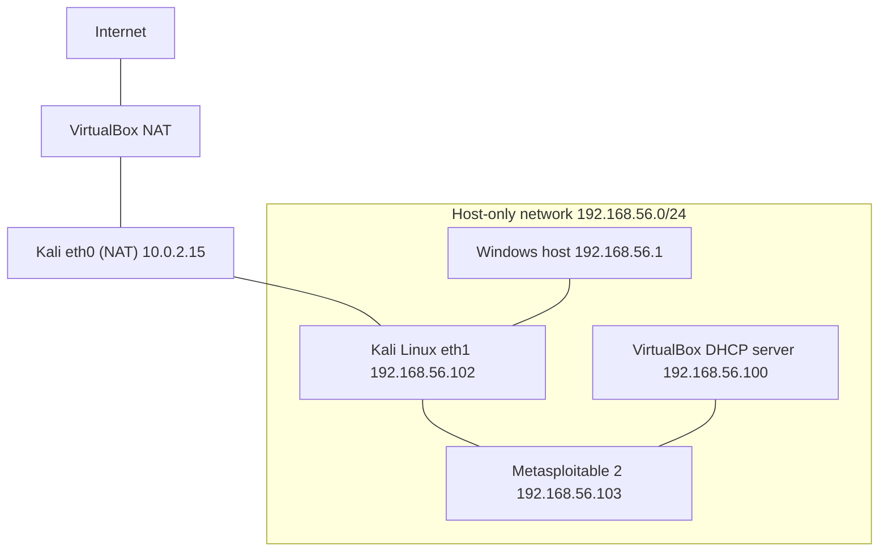

# Lab Network Diagram

Isolated penetration-testing lab built on VirtualBox. All attack practice happens inside the host-only network `192.168.56.0/24`. Only Kali has an internet path (NAT), used for updates. The vulnerable target has none.

## Diagram



## Machines

| Machine | Role | Network adapters | IP address |
|---|---|---|---|
| Kali Linux (VM) | Attacker / analysis workstation | Adapter 1: NAT, Adapter 2: Host-only | eth0 `10.0.2.15` (NAT, verify with `ip a`), eth1 `192.168.56.102` |
| Metasploitable 2 (VM) | Deliberately vulnerable target (includes DVWA) | Adapter 1: Host-only only | `192.168.56.103` |
| Windows PC | VirtualBox host | VirtualBox Host-Only adapter | `192.168.56.1` |
| VirtualBox DHCP server | Assigns addresses on the host-only network | Internal service | `192.168.56.100` |

## Isolation design

- Metasploitable 2 is attached to the host-only network only. It has **no route to the internet** by design.
- Kali's NAT adapter allows outbound traffic only (package updates). Nothing from outside can reach Kali or the target.
- Scanning and attacks are limited to `192.168.56.103`. The Windows host (`.1`) and DHCP server (`.100`) are not targets.
- No bridged adapters and no port forwarding are used anywhere in the lab.

## How the VMs communicate

The host-only network is a virtual switch inside VirtualBox. Kali and Metasploitable share the same subnet, so Kali reaches the target directly using ARP and Ethernet frames, without a router. None of this traffic touches the physical Wi-Fi or LAN.

## Verification

Run from Kali:

```
ip -br a
ping -c 3 192.168.56.103
sudo nmap -sn 192.168.56.0/24
```

Expected result: four hosts up (`.1`, `.100`, `.102`, `.103`) and replies from the target.
